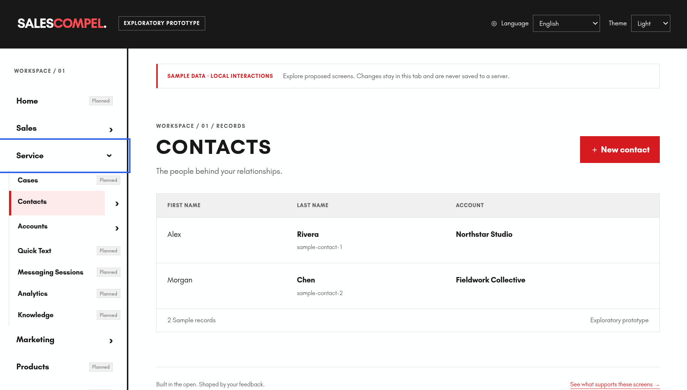

# SalesCompel

An open-source, free-to-use Salesforce replacement project, with an initial tenant-isolated Go/PostgreSQL candidate and Vue record workflow.

See the [first release roadmap](docs/superpowers/specs/2026-11-04-salescompel-first-release-roadmap-design.md) for the current order of work, and the [compatibility roadmap](docs/plans/2026-10-14-salesforce-compatibility-roadmap.md) for the proposed architecture, migration strategy, and certification milestones.

## UI prototype



The early Vue prototype lets people explore Account/Contact lists, details and
create/edit flows using synthetic data. It includes light/dark themes, Pinia,
Vue Router, localization and RTL support. Unimplemented destinations are disabled
and marked **Planned**. Preview edits stay in memory and do not call the backend.
See the [prototype walkthrough](docs/compat/ui/preview-walkthrough.md) to run it
locally and understand its scope.

## Roadmap and progress

The next goal is a `0.x` early preview for new teams and simple Salesforce orgs:
a working sales CRM with a Salesforce-compatible API that standard clients can
use, and an import with a dry-run report naming what will not carry over.

Apex, Flow and custom UI (LWC, Aura, Visualforce) are excluded from that first
release and come later. Orgs that rely on them will not be able to move yet. The
preview is not certified and does not claim 1:1 Salesforce compatibility. See the
[first release roadmap](docs/superpowers/specs/2026-11-04-salescompel-first-release-roadmap-design.md).

The table below tracks the longer-term certification milestones. Completed work
packages include the compatibility laboratory, the Go/PostgreSQL candidate
walking slice, an accepted eleven-scenario reference baseline, bounded
metadata/catalog improvements, external-ID body validation, atomic Composite
writes and the early UI prototype. These are subsystem deliveries; no full program
milestone has a recorded exit-gate pass yet.

| Milestone | Current status | Remaining focus |
| --- | --- | --- |
| M0 — Target inventory | Partial | Required features, integrations, packages and operating targets |
| M1 — Behavior laboratory | Partial; pilot baseline accepted | Broader client coverage, CLI/plugin runners and repeatable evidence |
| M1R — Release-history review | Partial | Complete source inventory and reconcile relevant changes |
| M2 — Platform walking slice | Walking slice accepted; milestone open | Remaining milestone dependencies and exclusions |
| M3 — Protocol and query fidelity | Early implementation | REST/query semantics, external IDs, SOAP, Bulk and identity |
| M4 — Metadata and security | Bounded slices implemented | Dynamic schema, deployment, permissions and sharing |
| M5 — Migration | Planning and contracts | Import/export, resumability, deltas and reconciliation |
| M6 — Sales workflows and UI | Early prototype implemented | Broader sales workflows, reporting and localized acceptance |
| M7 — Automation and customization | Feasibility work remains | Formulas, Flow, Apex and imported component runtimes |
| M8 — Integrations and events | Contract outlines | Integration APIs, event delivery and reconnect/retry behavior |
| M9 — Production certification | Not reached | Migration rehearsals, security, performance, recovery and cutover |
| M10 — Wider Salesforce coverage | Scope-dependent | Separate inventories and certification for additional clouds/profiles |

The first release budget is **roughly 21–31 feature-sized plans**, or about 26–42
with a rework reserve. Full certification through M9 remains a much larger effort:
the earlier estimate was **185–350 narrower plan equivalents**. These are rough
scope estimates, not delivery-date forecasts, and they are not directly comparable.
M10 needs separately bounded inventories.

OAuth login and identity now support authorization code with PKCE, refresh, JWT
bearer and client credentials. See the [Plan 26 operator guide and gaps](docs/compat/plan-26-oauth-login.md).
Plan 27 implementation adds explicit migrations, tenant row-level security and
dynamic objects and fields; see the [operator guide and current verification](docs/compat/plan-27-dynamic-schema.md). [Plan 25 foundation decisions](docs/compat/plan-25-foundation-decisions.md)
now define the bounded REST, query and external-ID defaults and remaining gaps. See the
[progress roadmap and estimate assumptions](docs/plans/2026-10-20-progress-and-remaining-roadmap.md)
and the [full architecture and milestone gates](docs/plans/2026-10-14-salesforce-compatibility-roadmap.md).

## License

SalesCompel is licensed under the [Apache License, Version 2.0](LICENSE) (SPDX: Apache-2.0).

Contributions follow the [clean-room policy](CLEAN_ROOM.md).

## Compatibility laboratory

[Plan 1](docs/plans/2026-10-15-plan-1-compatibility-laboratory.md) is implemented as an offline specification and test laboratory. See [setup, live-test prerequisites, and recovery](docs/compat/README.md).

```sh
npm ci --prefix compat/clients/node --ignore-scripts
npm --prefix compat/clients/node run check
```

The candidate supports a [bounded atomic Composite write subset](docs/superpowers/specs/2026-11-04-plan-24-atomic-composite-writes-design.md): Account/Contact POST, PATCH and DELETE with explicit `allOrNone: true`, sequential execution and earlier-create ID references. Partial success, reads, query, upsert and nested Composite subrequests remain deferred.

The [candidate OpenAPI contract](api/candidate-openapi.yaml) describes the implemented routes and is served through authenticated GET `/services/data/v65.0/openapi.yaml`. The [broader proposed REST contract](api/openapi.yaml) retains future surfaces; see the [Plan 2 implementation guide](docs/compat/plan-2-implementation.md) for the candidate boundary. Official Salesforce schema fixtures retain their own licenses; see [provenance](compat/fixtures/openapi/salesforce/provenance.json). The [Plan 4 pilot baseline](docs/compat/plan-4-reference-baseline.md) records two repeatable live reference captures; no candidate Salesforce compatibility certification has been performed.

## Platform walking slice

[Plan 2](docs/superpowers/plans/2026-10-15-plan-2-platform-walking-slice.md) implements persistent Account/Contact CRUD, describe, limited queries, external-ID upsert, provisioned bearer authentication and a localized Vue editor. See the [setup and verification guide](docs/compat/plan-2-implementation.md). The roadmap also tracks [M1R release-history review](docs/plans/2026-10-14-salesforce-compatibility-roadmap.md#m1r--salesforce-release-notes-and-changelog-review).

The [Plan 16 local candidate acceptance](docs/compat/plan-16-cli-query-column-metadata.md) records two complete sequential passing runs across database, real clients, restart and browser gates.

The candidate is not production-ready or certified Salesforce-compatible. The eleven-scenario reference baseline is recorded; broader M1 obligations and the wider protocol/security/migration surfaces remain pending.

## Catalog upgrades

Plan 27 uses explicit, forward-only migrations rather than startup catalog
mutation. Stop old instances and back up first, then run `salescompel migrate up`
with `MIGRATION_DATABASE_URL`. Serve uses separate record (`DATABASE_URL`) and
identity (`AUTH_DATABASE_URL`) credentials and refuses owner privileges. Exact
legacy catalog v1/v2/v3 layouts are adopted without rewriting business or OAuth
state. Rollback restores the backup. See the [operator guide](docs/compat/plan-27-dynamic-schema.md#operator-setup-and-upgrade).
