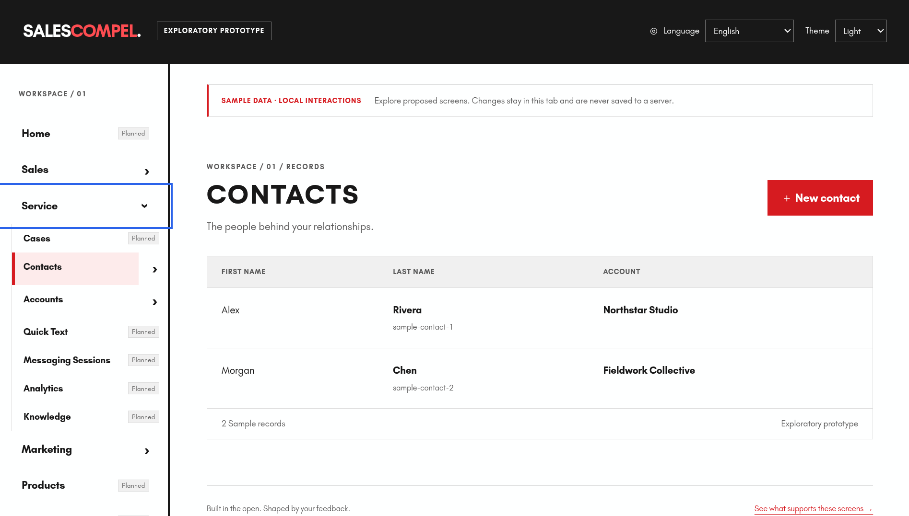

# SalesCompel

An open-source, free-to-use Salesforce replacement project, with an initial tenant-isolated Go/PostgreSQL candidate and Vue record workflow.

See the [compatibility roadmap](docs/plans/2026-10-14-salesforce-compatibility-roadmap.md) for the proposed architecture, migration strategy, and milestones.

## UI prototype



The early Vue prototype lets people explore Account/Contact lists, details and
create/edit flows using synthetic data. It includes light/dark themes, Pinia,
Vue Router, localization and RTL support. Unimplemented destinations are disabled
and marked **Planned**. Preview edits stay in memory and do not call the backend.
See the [prototype walkthrough](docs/compat/ui/preview-walkthrough.md) to run it
locally and understand its scope.

## Roadmap and progress

As of October 20, 2026, completed work packages include the compatibility
laboratory, the Go/PostgreSQL candidate walking slice, an accepted eleven-scenario
reference baseline, bounded metadata/catalog improvements, external-ID body
validation and the early UI prototype. These are subsystem deliveries; no full
program milestone has a recorded exit-gate pass yet.

| Milestone | Current status | Remaining focus |
| --- | --- | --- |
| M0 — Target inventory | Partial | Required features, integrations, packages and operating targets |
| M1 — Behavior laboratory | Partial; pilot baseline accepted | Broader client coverage, CLI/plugin runners and repeatable evidence |
| M1R — Release-history review | Partial | Complete source inventory and reconcile relevant changes |
| M2 — Platform walking slice | Implemented slice; acceptance open | Consolidated client, UI, isolation and restart acceptance |
| M3 — Protocol and query fidelity | Early implementation | REST/query semantics, external IDs, SOAP, Bulk and identity |
| M4 — Metadata and security | Bounded slices implemented | Dynamic schema, deployment, permissions and sharing |
| M5 — Migration | Planning and contracts | Import/export, resumability, deltas and reconciliation |
| M6 — Sales workflows and UI | Early prototype implemented | Broader sales workflows, reporting and localized acceptance |
| M7 — Automation and customization | Feasibility work remains | Formulas, Flow, Apex and imported component runtimes |
| M8 — Integrations and events | Contract outlines | Integration APIs, event delivery and reconnect/retry behavior |
| M9 — Production certification | Not reached | Migration rehearsals, security, performance, recovery and cutover |
| M10 — Wider Salesforce coverage | Scope-dependent | Separate inventories and certification for additional clouds/profiles |

The draft budget is **roughly 185–350 additional plan equivalents through M9**,
including discovery and rework reserve. This is a rough scope estimate, not a
delivery-date forecast; M10 needs separately bounded inventories. An early UI
track runs alongside foundation work so feedback can shape the product sooner.

Next priorities are closing foundation evidence gaps, resolving external-ID
equality and migration behavior, completing the target inventory, and testing
Apex/Flow/custom-UI feasibility early. See the
[progress roadmap and estimate assumptions](docs/plans/2026-10-20-progress-and-remaining-roadmap.md)
and the [full architecture and milestone gates](docs/plans/2026-10-14-salesforce-compatibility-roadmap.md).

## License

SalesCompel is licensed under the [Apache License, Version 2.0](LICENSE) (SPDX: Apache-2.0).

Contributions follow the [clean-room policy](CLEAN_ROOM.md).

## Compatibility laboratory

[Plan 1](docs/plans/2026-10-15-plan-1-compatibility-laboratory.md) is implemented as an offline specification and test laboratory. See [setup, live-test prerequisites, and recovery](docs/compat/README.md).

```sh
npm ci --prefix compat/clients/node --ignore-scripts
npm --prefix compat/clients/node run check
```

The [OpenAPI 3.2 REST contract](api/openapi.yaml) is a proposed broader subset; the [Plan 2 implementation guide](docs/compat/plan-2-implementation.md) lists the routes served by the candidate. Official Salesforce schema fixtures retain their own licenses; see [provenance](compat/fixtures/openapi/salesforce/provenance.json). The [Plan 4 pilot baseline](docs/compat/plan-4-reference-baseline.md) records two repeatable live reference captures; no candidate Salesforce compatibility certification has been performed.

## Platform walking slice

[Plan 2](docs/superpowers/plans/2026-10-15-plan-2-platform-walking-slice.md) implements persistent Account/Contact CRUD, describe, limited queries, external-ID upsert, provisioned bearer authentication and a localized Vue editor. See the [setup and verification guide](docs/compat/plan-2-implementation.md). The roadmap also tracks [M1R release-history review](docs/plans/2026-10-14-salesforce-compatibility-roadmap.md#m1r--salesforce-release-notes-and-changelog-review).

The candidate is not production-ready or certified Salesforce-compatible. The eleven-scenario reference baseline is recorded; broader M1 obligations and the wider protocol/security/migration surfaces remain pending.

## Catalog upgrades

The candidate now uses catalog version 2 with 80-character bounds for both synthetic
Account custom fields. Existing databases upgrade transactionally at startup;
oversized values block the upgrade without changing data. Stop old instances and
back up before upgrading. See the [Plan 8 upgrade and rollback guide](docs/compat/plan-8-active-field-metadata.md).
